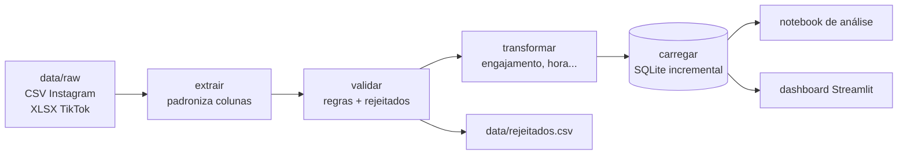
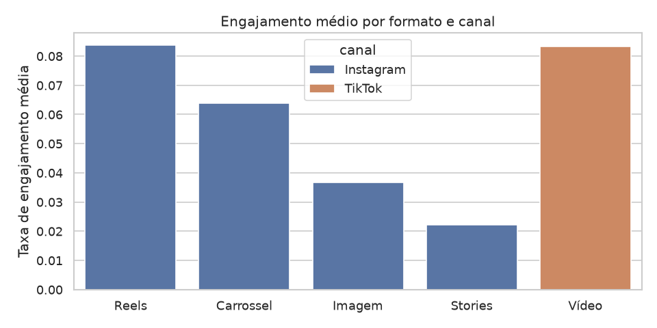
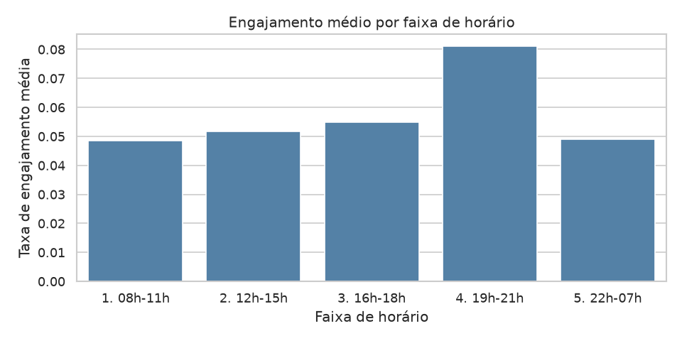

# Pipeline de métricas de redes sociais

> Dados 100% sintéticos, inspirados em um fluxo real de relatórios de social media.
> A marca ("Marca Exemplo") é fictícia.

Projeto de estudo: um pipeline ETL em Python que lê exportações semanais de Instagram e TikTok
(com os problemas típicos de arquivos reais), valida, calcula métricas, guarda tudo em SQLite
e alimenta um notebook de análise e um dashboard em Streamlit.

## Problema de negócio

Uma equipe de social media recebe toda semana exportações de cada plataforma, com colunas com nomes
diferentes, datas em formatos misturados, números escritos como texto e linhas repetidas. Juntar isso
na mão em planilha é lento e propenso a erro. O objetivo é automatizar: transformar essas exportações
em uma base única e confiável e responder perguntas como *qual formato engaja mais?*,
*qual o melhor horário para publicar?* e *como o alcance evoluiu?*

## Fluxo



## Como rodar

Precisa do [uv](https://docs.astral.sh/uv/) instalado.

```bash
uv sync                                  # instala as dependências
uv run python scripts/gerar_dados.py     # gera os dados sintéticos em data/raw/
uv run python -m pipeline.main           # roda o pipeline (pode rodar várias vezes)
uv run streamlit run app/dashboard.py    # abre o dashboard
```

Testes: `uv run pytest -q`. O notebook está em `notebooks/analise.ipynb` (já executado).

## Estrutura

```
scripts/gerar_dados.py    gera as exportações sintéticas (seed fixa)
src/pipeline/             extrair.py, validar.py, transformar.py, carregar.py, main.py
sql/                      schema.sql (tabelas) e consultas.sql (7 consultas de negócio)
notebooks/analise.ipynb   análise com gráficos e conclusões
app/dashboard.py          dashboard Streamlit
tests/                    testes com pytest
```

## Problemas nos dados e como o pipeline trata cada um

| Problema (injetado em `gerar_dados.py`) | Tratamento |
|---|---|
| Nomes de coluna diferentes entre canais e semanas (`Alcance` / `alcance_total`) | Dicionário explícito `MAPA_COLUNAS` em `extrair.py`; coluna desconhecida interrompe com erro claro |
| Datas em dois formatos (`dd/mm/aaaa HH:MM` e ISO) | `converter_data` tenta os dois formatos |
| Números como texto com milhar (`"1.234"`) | Arquivos lidos como texto; `converter_numero` remove o ponto |
| Data impossível (`31/02/2026`) | Linha rejeitada ("data inválida") |
| Valores faltantes (alcance, tema) | Rejeitada ("campo obrigatório ausente") |
| Valores negativos | Rejeitada ("métrica negativa") |
| Curtidas maiores que visualizações | Rejeitada |
| Linhas duplicadas e arquivo semanal reenviado | Fica a primeira ocorrência **válida** de `(canal, id_post)`; as demais são rejeitadas ("duplicado"). Os arquivos são lidos com o original antes do reenvio |
| TikTok não exporta salvamentos | Coluna fica vazia; conta como 0 no engajamento. Para comparar canais usa-se a taxa sem salvamentos |

As linhas rejeitadas vão para `data/rejeitados.csv` com os valores originais e o motivo.

A carga é **incremental**: `INSERT OR IGNORE` (um único commit por execução) com chave primária `(canal, id_post)`. Rodar o pipeline
duas vezes não duplica posts, e cada execução fica registrada na tabela `cargas`.

## Principais achados

(Detalhes e todos os gráficos em `notebooks/analise.ipynb`.)

- Reels e vídeos de TikTok engajam cerca de 8% do alcance, contra ~3,7% de Imagem e ~2,2% de Stories.
- Posts entre 19h e 21h têm o maior engajamento (~8% contra ~5% nas outras faixas).
- O alcance médio por post cresce: comparando as 4 primeiras com as 4 últimas semanas, +38% no
  Instagram (5.661 para 7.796) e +24% no TikTok (14.750 para 18.319).
- Na taxa comparável entre canais (sem salvamentos, que o TikTok não exporta), o TikTok engaja ~8,3%
  e o Instagram ~4,6%. Parte da diferença é o mix de formatos (o TikTok só tem vídeo).
- O dia da semana quase não faz diferença.





## Decisões e limitações

- **Taxa de engajamento** = (curtidas + comentários + compartilhamentos + salvamentos) / alcance.
  Com alcance 0 o resultado é `NaN` (indefinido), para não dividir por zero; salvamentos ausentes valem 0.
  Como o TikTok não tem salvamentos, a comparação entre canais usa `taxa_engajamento_sem_salvos`
  = (curtidas + comentários + compartilhamentos) / alcance.
- **Engajamento médio** nas consultas é a média das taxas dos posts (cada post pesa igual),
  e não a soma das interações dividida pela soma dos alcances.
- Suposição: o ponto nos números é sempre separador de milhar (são contagens inteiras).
- Cada execução relê todos os arquivos de `data/raw/`; a idempotência vem do `INSERT OR IGNORE`.
  Um post já carregado **não é atualizado** se o arquivo mudar depois.
- Dados sintéticos: os padrões foram colocados de propósito, então aparecem mais "limpos" que
  em dados reais. Análise só descritiva (sem testes estatísticos), 12 semanas e ~300 posts.

## O que eu aprenderia em seguida

- Fazer a carga atualizar posts já existentes (UPSERT), pois as métricas de um post mudam com o tempo.
- Testes estatísticos simples para saber se as diferenças entre formatos e horários são significativas.
- Ler dados direto de APIs das plataformas, em vez de arquivos exportados.
- Agendar a execução automática do pipeline.

## Autor

Luccas Nunes - [github.com/luccas-data](https://github.com/luccas-data)
